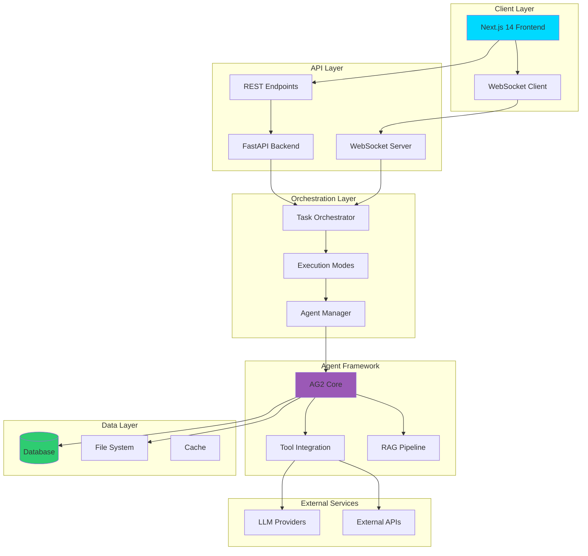
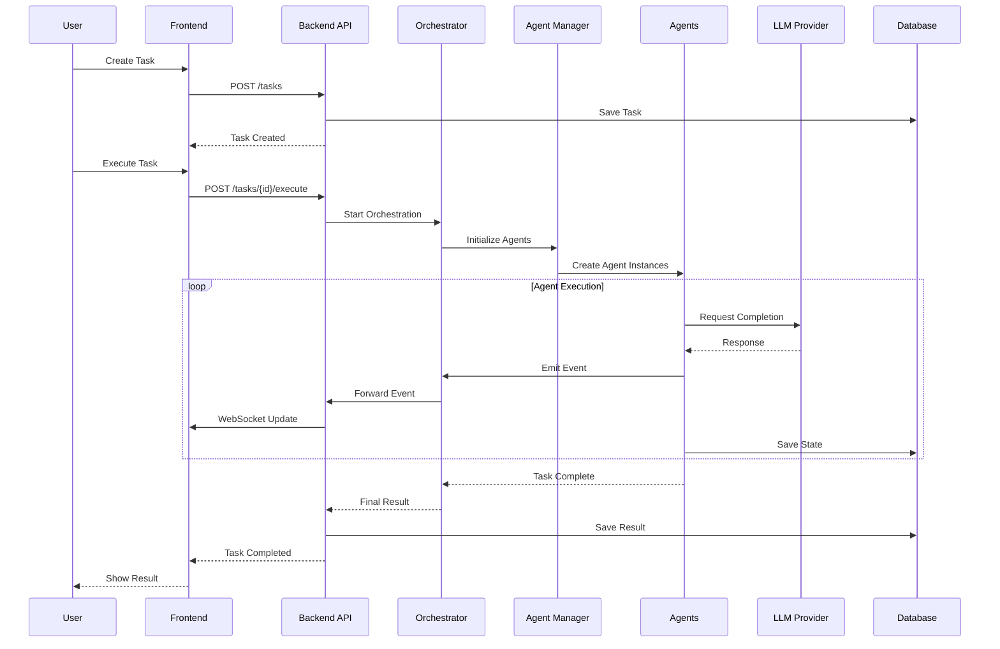
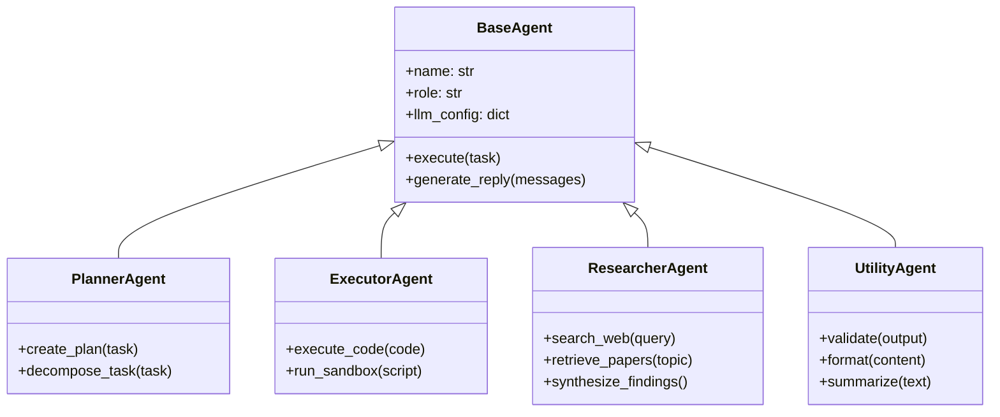
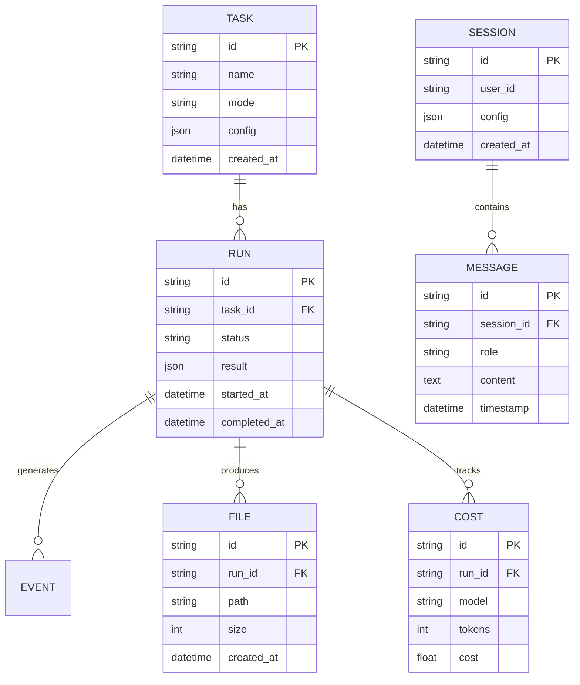
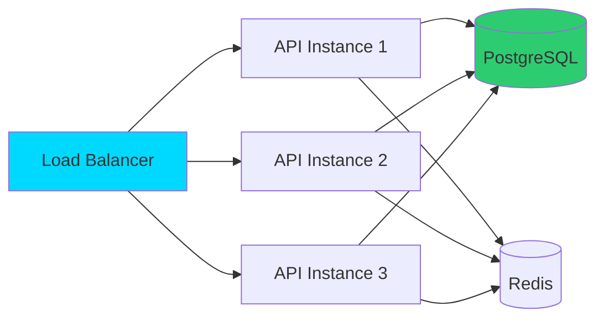

# 🏗️ MARS Architecture

<div align="center">

**Multi-Agent Research System - Technical Architecture**


</div>

## 📋 Table of Contents

- [System Overview](#-system-overview)
- [Architecture Layers](#-architecture-layers)
- [Component Details](#-component-details)
- [Data Flow](#-data-flow)
- [Agent System](#-agent-system)
- [Execution Modes](#-execution-modes)
- [Database Schema](#-database-schema)
- [API Design](#-api-design)
- [Security](#-security)
- [Performance](#-performance)
- [Deployment](#-deployment)

## 🌐 System Overview

MARS is built on a modern, scalable architecture that separates concerns across multiple layers:



## 🏛️ Architecture Layers

### 1. 🎨 Frontend Layer (Presentation)

**Technology**: Next.js 14, React 18, TypeScript

```
mars-ui/
├── app/                    # Next.js 14 App Router
│   ├── page.tsx           # Main dashboard
│   ├── tasks/             # Task management pages
│   ├── sessions/          # Copilot session pages
│   └── api/               # API route handlers
├── components/            # React components
│   ├── ui/               # Base UI components
│   ├── task/             # Task-related components
│   ├── agent/            # Agent visualization
│   └── dag/              # DAG visualization
├── contexts/             # React contexts
├── hooks/                # Custom React hooks
├── lib/                  # Utility libraries
└── types/                # TypeScript definitions
```

**Key Features**:
- 📊 Real-time DAG visualization using @xyflow/react
- 🔄 WebSocket-based live updates
- 🎯 Task configuration builder
- 💬 Copilot chat interface
- 📈 Cost and performance monitoring

### 2. ⚡ Backend Layer (API & Business Logic)

**Technology**: FastAPI, Uvicorn, Python 3.12+

```
backend/
├── main.py                # FastAPI application
├── run.py                 # Server runner
├── routers/              # API route modules
│   ├── tasks.py          # Task management
│   ├── runs.py           # Execution management
│   ├── sessions.py       # Copilot sessions
│   ├── deepresearch.py   # Deep research endpoints
│   └── arxiv.py          # Literature endpoints
├── services/             # Business logic services
│   ├── task_service.py
│   ├── agent_service.py
│   └── llm_service.py
├── models/               # Pydantic models
├── core/                 # Core functionality
├── websocket/            # WebSocket handling
├── callbacks/            # Event callbacks
└── execution/            # Task execution engine
```

**Key Features**:
- 🚀 Async/await for non-blocking operations
- 🔌 WebSocket server for real-time updates
- 🗃️ SQLAlchemy ORM for database operations
- ✅ Pydantic models for data validation
- 📝 Structured logging with contextual information

### 3. 🤖 Agent Framework Layer (Core Intelligence)

**Technology**: AG2 (AutoGen 2), LangChain, CrewAI

```
cmbagent/
├── agents/               # Agent definitions
│   ├── planner.py       # Planning agents
│   ├── executor.py      # Execution agents
│   ├── researcher.py    # Research agents
│   └── utility.py       # Utility agents
├── orchestrator/        # Agent orchestration
│   ├── workflow.py      # Workflow management
│   ├── context.py       # Context management
│   └── coordinator.py   # Agent coordination
├── execution/           # Execution engines
│   ├── one_shot.py     # Single-pass execution
│   ├── planning.py     # Planning-control mode
│   ├── adversarial.py  # Idea generation mode
│   └── hitl.py         # Human-in-the-loop
├── functions/           # Tool functions
├── external_tools/      # External tool integration
├── mcp/                 # Model Context Protocol
├── rag_utils.py        # RAG pipeline
└── llm_provider.py     # LLM client management
```

**Key Features**:
- 🔄 Dynamic agent composition
- 🧠 Context preservation across interactions
- 🛠️ Pluggable tool system
- 📚 RAG pipeline for knowledge retrieval
- 🔀 Multi-mode execution strategies

### 4. 💾 Data Layer (Persistence)

**Technology**: SQLAlchemy, Alembic, SQLite/PostgreSQL

```sql
-- Core Tables
tasks          -- Task definitions
runs           -- Execution runs
sessions       -- Copilot sessions
messages       -- Chat messages
agents         -- Agent metadata
files          -- Generated files
costs          -- Token usage tracking
events         -- Audit logs
```

**Key Features**:
- 🔄 Alembic migrations for schema evolution
- 🔍 Indexed queries for performance
- 📊 JSONB columns for flexible data
- 🔐 Encrypted sensitive data
- 📝 Comprehensive audit trails

## 🔧 Component Details

### Task Orchestrator

The orchestrator is the brain of MARS, coordinating agent interactions:

```python
class TaskOrchestrator:
    """
    Orchestrates multi-agent task execution.
    
    Responsibilities:
    - Mode selection and configuration
    - Agent lifecycle management
    - Context propagation
    - Error handling and recovery
    - Event emission for UI updates
    """
    
    def __init__(self, config: TaskConfig):
        self.config = config
        self.agents = AgentManager()
        self.context = ExecutionContext()
        
    async def execute(self) -> TaskResult:
        """Execute task with selected mode."""
        mode = self.select_mode()
        agents = await self.agents.initialize(mode)
        
        async for event in mode.execute(agents, self.context):
            await self.emit_event(event)
            
        return await self.finalize()
```

### Agent Manager

Manages the lifecycle of 50+ specialized agents:

```python
class AgentManager:
    """
    Manages agent initialization, coordination, and cleanup.
    """
    
    agents: Dict[str, BaseAgent] = {
        # Planning Agents
        "planner": PlannerAgent(),
        "task_improver": TaskImproverAgent(),
        "plan_reviewer": PlanReviewerAgent(),
        
        # Execution Agents
        "engineer": EngineerAgent(),
        "researcher": ResearcherAgent(),
        "executor": ExecutorAgent(),
        
        # Retrieval Agents
        "web_surfer": WebSurferAgent(),
        "rag_agents": RAGAgent(),
        
        # Utility Agents
        "idea_maker": IdeaMakerAgent(),
        "idea_hater": IdeaHaterAgent(),
        "summarizer": SummarizerAgent(),
    }
    
    def get_agents_for_mode(self, mode: str) -> List[BaseAgent]:
        """Get required agents for execution mode."""
        return MODE_AGENT_MAPPING[mode]
```

### WebSocket Event System

Real-time updates via WebSocket:

```typescript
// Event Types
interface WebSocketEvents {
  // Task status updates
  status: {
    task_id: string;
    status: TaskStatus;
    progress: number;
  };
  
  // Agent output streaming
  output: {
    agent: string;
    content: string;
    timestamp: number;
  };
  
  // DAG visualization updates
  dag_update: {
    nodes: Node[];
    edges: Edge[];
  };
  
  // Human approval requests
  approval_request: {
    message: string;
    options: string[];
    context: any;
  };
  
  // Cost tracking
  cost_update: {
    tokens: number;
    cost: number;
    model: string;
  };
}
```

## 🔄 Data Flow

### Task Execution Flow



## 🤖 Agent System

### Agent Hierarchy



### Agent Communication

Agents communicate via AG2's message-passing system:

```python
# Agent A sends message to Agent B
message = {
    "role": "user",
    "content": "Analyze this dataset",
    "metadata": {
        "task_id": "task_123",
        "context": {...}
    }
}

response = await agent_b.generate_reply(
    messages=[message],
    sender=agent_a
)
```

## 🎯 Execution Modes

### Mode Architecture

Each mode implements the `ExecutionMode` interface:

```python
class ExecutionMode(ABC):
    """Base class for execution modes."""
    
    @abstractmethod
    async def execute(
        self, 
        agents: List[BaseAgent],
        context: ExecutionContext
    ) -> AsyncIterator[Event]:
        """Execute task with mode-specific logic."""
        pass
```

### Mode Implementations

1. **One-Shot Mode**: Direct single-agent execution
2. **Planning-Control**: Planner → Execution → Review
3. **Idea Generation**: Adversarial idea_maker ↔ idea_hater loop
4. **HITL Interactive**: Approval checkpoints at each step
5. **Copilot**: Conversational with persistent context
6. **OCR**: Document extraction pipeline
7. **ArXiv**: Literature discovery and synthesis
8. **Enhance Input**: Pre-processing with enrichment

## 🗃️ Database Schema

### Entity Relationship Diagram



## 🔐 Security

### Authentication & Authorization

- 🔑 API key-based authentication for external services
- 🛡️ Environment variable management for secrets
- 🔒 No user authentication (single-user deployment)

### Data Security

- ✅ Input validation with Pydantic
- 🧹 Output sanitization
- 📁 Sandboxed code execution
- 🔐 Encrypted sensitive data in database

### Network Security

- 🌐 CORS configuration for frontend access
- 🔒 HTTPS in production (via reverse proxy)
- 🚫 Rate limiting on API endpoints
- 🛡️ WebSocket origin validation

## ⚡ Performance

### Optimization Strategies

1. **Async Operations**: Non-blocking I/O throughout
2. **Connection Pooling**: Database and HTTP connection reuse
3. **Caching**: LLM response caching for common queries
4. **Streaming**: Incremental output via WebSocket
5. **Background Tasks**: Long-running operations in background

### Scaling Considerations



## 🚀 Deployment

### Development

```bash
# Backend
cd backend && python run.py

# Frontend
cd mars-ui && npm run dev
```

### Production

```dockerfile
# Multi-stage Docker build
FROM python:3.12-slim as backend
WORKDIR /app
COPY . .
RUN pip install -e .

FROM node:18-alpine as frontend
WORKDIR /app
COPY mars-ui/ .
RUN npm install && npm run build

FROM nginx:alpine
COPY --from=backend /app /backend
COPY --from=frontend /app/.next /frontend
```

### Infrastructure

```yaml
# docker-compose.yml
version: '3.8'
services:
  backend:
    build: .
    ports:
      - "8000:8000"
    environment:
      - DATABASE_URL=postgresql://...
    
  frontend:
    build: ./mars-ui
    ports:
      - "3000:3000"
    depends_on:
      - backend
    
  db:
    image: postgres:15
    volumes:
      - pgdata:/var/lib/postgresql/data
```

---

<div align="center">

**MARS Architecture Documentation**

Maintained by **Keshav**


</div>
